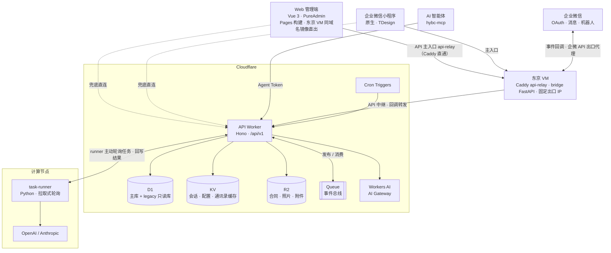
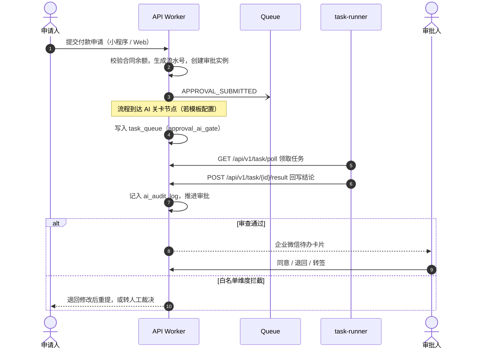

<div align="center">

# 恒越百川 · HYBC Core

**恒越百川建设集团后台管理系统**

项目 · 财务 · 施工日志 · 库房资产 · 审批，一体化业务平台<br/>
以企业微信为身份底座，AI 辅助审查与决策，全栈运行于 Cloudflare

[](https://github.com/zliu259/hybc_core/actions/workflows/ci.yml)


[项目简介](#项目简介) · [功能模块](#功能模块) · [系统架构](#系统架构) · [快速开始](#快速开始) · [部署与发布](#部署与发布) · [文档导航](#文档导航)

</div>

---

## 项目简介

HYBC Core 是恒越百川建设集团（顶管施工与技术研发）的业务管理平台，把「项目现场 → 审批流 → 财务流 → 资产流」收进同一套系统闭环：管理与财务岗位使用 **Web 管理端**，一线现场人员使用 **企业微信小程序**，所有人以企业微信身份登录。集团下辖劳务、机械、市政等多个法律实体，系统不做实体切换，而是在财务操作时选择对应实体账户。

**设计要点**

- **企业微信即身份** —— 企微 `userid` 是唯一身份标识，不另建用户表；Web 扫码 / 企微内 OAuth 登录，可绑定 Passkey；审批待办、群消息与智能机器人全部走企业微信。
- **自研审批引擎** —— 顺序签、会签、或签、抄送、自动、AI 关卡六类节点，支持金额阈值路由、退回（发起人 / 上一节点 / 指定节点）、转签、撤回、重新提交，配有可视化流程设计器。
- **AI 异步辅助、全程留痕** —— 合同审查、付款风险评估、报销查重、日志智能填写、设备推荐等经 AI Slot 抽象层异步执行，不阻塞用户提交，结果统一写入 `ai_audit_log`。AI 关卡只在白名单维度上有拦截权，拦截即退回改单，误判可转人工裁决。
- **Serverless 全栈** —— API 运行于 Cloudflare Workers，数据落在 D1 / KV / R2，事件经 Queue 解耦，定时任务由 Cron Triggers 驱动；重计算下沉到拉取式 Python 计算节点（节点不开放入站端口）。
- **面向大陆网络** —— 部署在海外固定出口 IP 上的 bridge 中继，承担企微回调接入、企微 API 出口代理与小程序 API 中继；网页端 API 经同机 Caddy 的 `api-relay.hybcdg.com` 直通 Worker，网页本身也以同域名 `web.hybcdg.com` 从这台 VM 直出（Caddy 反代 Pages 源站，证书走 Cloudflare DNS-01），整站绕开大陆到 Cloudflare 边缘的慢链路；Worker 凭可信中转头取回真实客户端 IP。
- **AI 智能体接入** —— `hybc-mcp` 让 Claude 等 MCP 客户端以员工身份查询业务数据；审批类写操作必须由本人在企业微信确认后才真正执行。
- **推送即发布** —— push 到 `main` 即自动部署 API 与 Web，CI 对每次推送执行类型检查、测试与 lint。

## 功能模块

| 模块 | 主要能力 | 使用端 |
| --- | --- | --- |
| 项目与现场 | 项目立项、项目选择大厅、项目工作区、标段进度；外包日志工作台（外部单位凭链接填报，AI 预审后人工复核） | Web · 小程序 |
| 审批中心 | 待办 / 已办 / 我发起的、流转轨迹、退回修改后重提、审批监控台；企业微信待办卡片直达小程序审批页 | Web · 小程序 · 企微 |
| 合同 | 统一合同台账（对外 / 对内）、合同执行监控、金额变更、AI 合同审查 | Web · 小程序（查询） |
| 付款 | 智能发单台、对外付款（合同驱动，累计不超合同额）、对内付款、收款人管理、AI 付款风险评估 | Web · 小程序 |
| 报销 | 信封制报销（实物 + 电子双通道，UUID 二维码识别）、电子发票查重、发票抬头、集中审批、集中打款、信封生成器 | Web · 小程序 |
| 收款 | 收款合同 → 开票申请（可多张，不超合同额）→ 收款登记、收款工作台 | Web · 小程序（查询） |
| 施工日志 | 操作员日志（AI 辅助填写）、管理员日志、贯通报告、现场勘查、日志公示看板、进度预警、漏报检测 | Web · 小程序 |
| 库房与资产 | 有状态资产（唯一身份码、档案与事件时间线）、无状态物料与消耗品、出入库制单、调度、盘库、返库检查维护、资产工单、顶管机组合方案与搭配模板、操作手册库 | Web · 小程序 |
| 车辆中心 | 油卡额度申请与处理工作台、车辆油卡档案、用油健康总览、车辆保养记录 | Web · 小程序 |
| 实用工具 | 投标文件查重对比（含 AI 改写建议）、AI 合同生成（逐节起草、合规审查、完整性检查，导出 Word）、合同预审（对方合同 AI 合规审计） | Web · 小程序（预审） |
| 个人工作台 | 今日待办、我的报销、我的申请、发起付款 / 油卡申请 | Web · 小程序 |
| 系统设置 | 审批流程设计器、阈值管控中心、AI 引擎配置、AI 关卡任务、Runner 监控、智能体接入与设备授权、企微集成 / 智能机器人 / 推送监控、服务监控、业务数据运维台、IT 支持工单、实体与字典 | Web |

**角色与权限**：内置五类角色——超级管理员 `super_admin`、财务 `finance`、经理 `manager`、现场管理员 `site_manager`、现场操作员 `operator`。角色由企业微信标签映射，API 层统一做 RBAC 校验；现场管理员限所属项目范围，现场操作员仅能看到本人数据。

## 系统架构



### 核心引擎

以下路径均相对于 `packages/api/src/`。

- **审批引擎**（`services/approval/`）—— 模板解析 → 动态路由（金额阈值、实例级二次设置）→ 节点执行器。支持退回、拒绝、转签、撤回、取消与重新提交；AI 关卡任务按轮次匹配，重提后重新审查，不复用上一轮结论。
- **AI 决策引擎**（`services/ai-slot.ts`、`services/cf-ai.ts`）—— 业务方只创建 `task_queue` 任务，由 `ai_routing_rule` 选择 Provider 与提示词模板。合同起草、合规审查、完整性检查、预审审计在 Worker 内经 Cloudflare AI 直接执行（`cf_ai`）；其余 AI、OCR、文件生成任务由 task-runner 节点领取执行。
- **事件总线**（`services/event-bus.ts`、`queue-handler.ts`）—— Cloudflare Queue 承载审批提交、节点进入、退回、转签、AI 转人工等事件，驱动企微推送与业务回写，事件落库 `event_log`。
- **定时自动化**（`scheduled.ts`、`services/cron-jobs.ts`）—— Cron Triggers 负责超时检测、节点心跳、任务重排、通讯录刷新、漏报检测等。早期的 n8n 编排已下线，统一为 Worker Cron + task-runner。

### 一张付款单的生命周期



<details>
<summary><b>定时任务一览</b>（<code>packages/api/wrangler.toml</code> · <code>src/scheduled.ts</code>）</summary>

| Cron（UTC） | 频率（北京时间） | 任务 |
| --- | --- | --- |
| `*/2 * * * *` | 每 2 分钟 | 按任务积压唤醒容器 runner、节点心跳检测、任务超时重排、`cf_ai` 任务兜底补执行、合同预审卡单回收、车辆通知投递 |
| `0 * * * *` | 每小时整点 | 审批超时检查、企微通讯录缓存刷新、资产租赁逾期标记、智能体待确认动作清理、车辆超时提醒 |
| `0 18 * * *` | 每天 02:00 | 施工日志漏报检测、报销数据完整性巡检 |

</details>

<details>
<summary><b>API 路由一览</b>（统一前缀 <code>/api/v1</code>，注册于 <code>packages/api/src/index.ts</code>）</summary>

| 前缀 | 说明 |
| --- | --- |
| `/system` | 健康检查、存储自检、自动化入口、bridge 回调接入 |
| `/auth` · `/passkeys` · `/user` | 企微 OAuth / 小程序登录、令牌刷新、Passkey、当前用户 |
| `/entity` · `/dict` | 经营实体、数据字典 |
| `/project` · `/public/project-log` | 项目；外包日志公开工作台（凭 token 链接访问） |
| `/contract` · `/contract-draft` · `/contract-precheck` | 合同台账、AI 合同起草、合同预审 |
| `/payment` · `/reimbursement` · `/receipt` | 付款、报销、收款与发票 |
| `/log` · `/survey` | 施工日志、现场勘查 |
| `/approval` | 审批实例、待办与审批操作 |
| `/asset` · `/warehouse` · `/warehouse/manual` · `/warehouse/work-order` | 资产、库房、操作手册、资产工单 |
| `/fleet` · `/fleet/maintenance` | 车辆油卡、车辆保养 |
| `/bidding` | 投标查重 |
| `/task` | 计算节点注册、心跳、领取任务、回写结果（`X-API-Key` 鉴权） |
| `/upload` | R2 签名上传与文件读取 |
| `/voice` | 语音转写与指令解析（小程序语音助手） |
| `/wecom` | 企业微信智能机器人工具 |
| `/agent` | 智能体设备授权、令牌、MCP 分发 |
| `/vertex` · `/internal/vertex-handoff` | Vertex 现场控制区单点登录（一次性 code 换取身份） |
| `/support` | IT 支持工单 |
| `/admin` · `/dashboard` | 系统管理、仪表盘 |

</details>

## 技术栈

| 层 | 技术 |
| --- | --- |
| 后端 API | Cloudflare Workers · Hono 4 · TypeScript · D1（SQLite）· KV · R2 · Queues · Cron Triggers · Workers AI / AI Gateway |
| Web 管理端 | Vue 3.5 · Vite 7 · [pure-admin-thin](https://github.com/pure-admin/pure-admin-thin) · Element Plus · Pinia · Tailwind CSS 4 · ECharts · Vue Flow · docx / pdf.js |
| 小程序 | 企业微信小程序（原生 JS）· TDesign Miniprogram · uCharts |
| 计算节点 | Python 3.11 · httpx · OpenAI / Anthropic SDK · PyMuPDF / pypdf · python-docx / openpyxl / reportlab · Docker / Cloudflare Containers |
| bridge 中继 | FastAPI · Uvicorn · httpx · Caddy（自动 TLS）· systemd |
| 智能体接入 | Model Context Protocol SDK · zod · esbuild |
| 工程化 | pnpm workspace · Vitest · ESLint · Prettier · Stylelint · vue-tsc · GitHub Actions |

## 目录结构

```text
hybc_core/
├── packages/
│   ├── api/                    # 后端：Hono on Cloudflare Workers
│   │   ├── src/
│   │   │   ├── index.ts        # 应用入口，注册 /api/v1/* 路由
│   │   │   ├── routes/         # 按业务域划分的路由
│   │   │   ├── services/       # 业务逻辑：AI Slot、事件总线、企微、库房、智能体……
│   │   │   │   └── approval/   # 审批引擎：路由、执行器、AI 关卡
│   │   │   ├── middleware/     # JWT 鉴权、RBAC、API Key、限流、CORS、日志、错误处理
│   │   │   ├── types/          # 领域类型（env.ts 定义全部 Cloudflare 绑定）
│   │   │   ├── queue-handler.ts  # Queue 消费者
│   │   │   └── scheduled.ts    # Cron 定时任务
│   │   ├── migrations/         # D1 迁移 NNNN_description.sql
│   │   ├── scripts/            # 模拟数据、旧数据导入、迁移编号检查
│   │   ├── test/               # 跨模块回归测试
│   │   └── wrangler.toml
│   ├── web/                    # Web 管理端：Vue 3 + PureAdmin（Cloudflare Pages）
│   │   ├── src/                # views / api / store / router / composables / components
│   │   ├── functions/          # Pages Functions（拦截 /static/* 缓存中毒）
│   │   └── public/             # _headers / _redirects
│   ├── miniapp/                # 企业微信小程序：pages + 分包 packageFinance / packageProject / packageTools
│   └── mcp/                    # hybc-mcp：AI 智能体接入（MCP Server + CLI）
├── task-runner/                # Python 计算节点：providers / tasks / importers
├── .cf-runner-container/       # task-runner 的 Cloudflare Containers 部署包（runner.hybcdg.com）
├── bridge/                     # 企微桥接与 API 中继（FastAPI，部署于海外 VM）
├── scripts/                    # 部署（deploy）、本地多节点（phase8）、证书（ssl）脚本
├── n8n/                        # 早期 n8n 工作流（已下线，仅留档）
├── doc/                        # 长期有效文档：架构、计划、开发记录、UI 设计、培训手册
├── docs/                       # archive（已实现）/ planned（待实现）/ superpowers（specs 与 plans）
├── .github/workflows/          # CI 与 bridge 自动部署
├── CLAUDE.md · AGENTS.md       # AI 编码助手的项目规则
└── pnpm-workspace.yaml
```

## 快速开始

本地开发全部走模拟环境：`wrangler dev --local` 在本机模拟 D1 / KV / R2 / Queue，AI 任务在没有模型密钥时自动退回本地规则，不需要任何云资源即可跑通主要业务链路。

### 环境要求

| 工具 | 版本 | 用途 |
| --- | --- | --- |
| Node.js | ≥ 20.19（推荐 22，见 `packages/web/.nvmrc`） | API / Web / MCP |
| pnpm | 10.x（CI 使用 10.22.0） | 包管理，Web 包强制使用 pnpm |
| Python | ≥ 3.11 | task-runner、bridge、旧数据导入脚本 |
| Docker | 可选 | 以容器方式运行 task-runner |
| 企业微信开发者工具 | 可选 | 调试小程序 |

### 1. 安装依赖

```bash
git clone https://github.com/zliu259/hybc_core.git
cd hybc_core
pnpm install
```

### 2. 启动 API

API 默认监听 `http://127.0.0.1:8787`。

```bash
cd packages/api
cp .dev.vars.example .dev.vars   # 必需：本地靠它把 APP_ENV 覆盖为 local
pnpm db:migrate:local            # 将迁移应用到本地 D1
pnpm db:seed:mock:local          # 可选：写入 MOCK-* 前缀的全链路模拟数据，可重复执行
pnpm dev
```

```bash
curl http://127.0.0.1:8787/api/v1/system/health   # 期望返回 ok=true
```

> `wrangler.toml` 顶层 `APP_ENV` 固定为 `production`（自动部署实际采用顶层 vars），所以缺少 `.dev.vars` 时本地无法使用免企微 code 登录。合同起草、预审等 `cf_ai` 能力在本地也会调用 Cloudflare 远端推理，调试它们需先执行 `npx wrangler login`。

### 3. 启动 Web 管理端

```bash
cd packages/web
pnpm dev
```

访问 `http://localhost:8849`。开发服务器把 `/api` 代理到 `http://127.0.0.1:8787`（可在 `.env.development` 中通过 `VITE_API_TARGET` 修改），路由为 hash 模式。

### 4. 本地登录

Web 登录页只提供企业微信扫码与 Passkey 两种方式。`APP_ENV=local` 时，API 允许不带企微 code、按用户名直接签发令牌，便于联调：

```bash
curl -X POST http://127.0.0.1:8787/api/v1/auth/login/web \
  -H 'content-type: application/json' \
  -d '{"username":"admin"}'
```

| 用户名 | 角色 |
| --- | --- |
| `admin` / `super_admin` | 超级管理员 |
| `finance` | 财务 |
| `manager` | 经理 |
| `site_manager` | 现场管理员 |
| 其他任意值 | 现场操作员 |

返回体中的 `data.accessToken` 以 `Authorization: Bearer <token>` 调用其他接口。在浏览器里走企业微信扫码登录，需要先在企微后台配置自建应用的可信域名、回调地址与企业可信 IP，见 [本地开发指南](doc/local-dev-setup.md)。

### 5. 启动计算节点（可选）

```bash
cd task-runner
cp .env.example .env
python -m venv .venv && source .venv/bin/activate
pip install -r requirements.txt
python -m runner.main
```

- 直接在本机运行时，把 `.env` 中的 `API_BASE_URL` 改为 `http://127.0.0.1:8787`；示例值 `host.docker.internal` 供 Docker 使用（`docker compose up -d`）。
- `API_KEY` 必须与 API 的 `TASK_API_KEY` 一致（两份示例文件已对齐）。
- 未配置 `OPENAI_API_KEY` / `ANTHROPIC_API_KEY` 时只启用本地规则 Provider；设 `MOCK_AI_ONLY=true` 可在有密钥时也强制走本地规则。
- 需要模拟主 / 备 / 冷备多节点与 mTLS 时，运行 `scripts/phase8/start-local.sh`。

### 6. 调试小程序（可选）

用企业微信开发者工具导入 `packages/miniapp`（AppID 见 `project.config.json`）。TDesign 组件已随仓库提供，无需「构建 npm」。

小程序默认经 bridge 中继（`https://bridge.hybcdg.com`）访问 API，失败时回退直连 Worker。联调时可在「我的 → 账号与配置 → 联调配置」中修改接口地址（写入本机缓存，逻辑见 `utils/config.js`）。小程序登录使用企业微信 code，连接本地 API 时需要在 `.dev.vars` 中填入真实的企业微信应用参数。

## 配置说明

密钥只有两个来源，互不重叠：**本地**是 `packages/api/.dev.vars`（已 gitignore），**生产**是 Worker Secrets（`npx wrangler secret put <NAME> --env prod`）。`JWT_SECRET`、`UPLOAD_SIGNING_SECRET`、`TASK_API_KEY`、`WECHAT_SECRET`、`WECHAT_BRIDGE_TOKEN`、`AGENT_REPLAY_SECRET` 绝不能写进 `wrangler.toml` 的任何 `vars` 段——同名明文 var 会和 secret 冲突，且一经提交便永久留在 git 历史里。回归测试 `packages/api/test/wrangler-prod-env.test.ts` 守护这条规则。

<details>
<summary><b>API · <code>packages/api/.dev.vars</code></b></summary>

| 变量 | 说明 | 生产来源 |
| --- | --- | --- |
| `APP_ENV` | 运行环境；本地必须为 `local` | `wrangler.toml` vars（`production`） |
| `JWT_SECRET` | 会话 JWT 签名密钥 | Secret |
| `UPLOAD_SIGNING_SECRET` | R2 上传签名密钥 | Secret |
| `TASK_API_KEY` | 计算节点调用 `/api/v1/task/*` 的 API Key | Secret |
| `AGENT_REPLAY_SECRET` | 智能体高危写操作重放标记的 HMAC 密钥（生产须为 ≥ 32 字符的强随机值） | Secret |
| `WECHAT_CORPID` · `WECHAT_AGENT_ID` | 企业微信企业 ID、自建应用 AgentId | `wrangler.toml` vars |
| `WECHAT_SECRET` | 企业微信自建应用 Secret | Secret |
| `WECHAT_REDIRECT_URI` | Web 扫码登录回调地址 | `wrangler.toml` vars |
| `WECHAT_BRIDGE_TOKEN` | 调用 bridge 企微出口代理的令牌 | Secret |
| `RELAY_TRUST_TOKEN` | 可信中转令牌：api-relay 的 Caddy 与 bridge 中继以 `X-Relay-Auth` 出示，Worker 据此采信 `X-Forwarded-For` 首跳为客户端 IP（与 GitHub secret `AZURE_BRIDGE_RELAY_TRUST_TOKEN` 同值） | Secret |
| `PASSKEY_RP_ID` · `PASSKEY_RP_NAME` | WebAuthn Relying Party 标识 | `wrangler.toml` vars |

完整绑定与可选变量见 [`packages/api/src/types/env.ts`](packages/api/src/types/env.ts)。

</details>

<details>
<summary><b>Web · <code>packages/web/.env.*</code></b></summary>

| 变量 | 说明 |
| --- | --- |
| `VITE_PORT` | 本地开发端口（8849） |
| `VITE_API_TARGET` | 开发代理目标，默认 `http://127.0.0.1:8787` |
| `VITE_API_BASE_URL` | 生产 / 预发布 API 基地址 |
| `VITE_WECOM_CORPID` · `VITE_WECOM_AGENT_ID` | 企业微信 JS-SDK 登录面板 |
| `VITE_VERTEX_BASE_URL` | Vertex 现场控制区入口 |
| `VITE_ROUTER_HISTORY` | 路由模式（`hash`） |

</details>

<details>
<summary><b>计算节点 · <code>task-runner/.env</code></b></summary>

| 变量 | 说明 |
| --- | --- |
| `API_BASE_URL` · `API_BASE_URL_FALLBACKS` | API 地址及备用地址 |
| `API_KEY` | 与 API 的 `TASK_API_KEY` 一致 |
| `CAPABILITIES` | 节点可领取的任务类型（逗号分隔，留空使用默认全集） |
| `MOCK_AI_ONLY` | `true` 时跳过云端模型，只用本地规则 |
| `OPENAI_API_KEY` · `OPENAI_MODEL*` | OpenAI Provider 及按任务的模型覆盖 |
| `ANTHROPIC_API_KEY` · `ANTHROPIC_MODEL` | Claude Provider |
| `POLL_INTERVAL_SECONDS` · `HEARTBEAT_INTERVAL_SECONDS` | 轮询与心跳间隔 |
| `TLS_CA_CERT_PATH` · `TLS_CLIENT_CERT_PATH` · `TLS_CLIENT_KEY_PATH` | 可选 mTLS |

</details>

## 开发指南

### 常用命令

| 位置 | 命令 | 说明 |
| --- | --- | --- |
| 仓库根目录 | `pnpm dev:api` · `pnpm dev:web` · `pnpm build:web` · `pnpm typecheck` | 快捷脚本：启动 API / Web、构建 Web、API + Web 类型检查 |
| `packages/api` | `pnpm dev` | 本地 Worker，状态持久化到 `.wrangler/state` |
| | `pnpm test` · `pnpm typecheck` · `pnpm lint` · `pnpm format` | Vitest / tsc / ESLint / Prettier 检查 |
| | `pnpm db:migrate:local` · `pnpm db:seed:mock:local` | 本地迁移 / 模拟数据 |
| `packages/web` | `pnpm dev` · `pnpm build` · `pnpm preview` | 开发 / 构建 / 预览 |
| | `pnpm test` · `pnpm typecheck` · `pnpm lint:check` | Vitest / vue-tsc / 只检查不修复的 lint |
| `packages/mcp` | `pnpm build` · `pnpm build:bundle` · `pnpm test` | 编译 / 打单文件 bundle / 测试 |
| `packages/miniapp` | `pnpm typecheck` · `node utils/<name>.test.js` | 类型检查 / 运行工具函数测试 |
| `task-runner` | `pytest` | Python 单元测试（pytest 不在 `requirements.txt` 中，需另行安装） |

也可以在仓库根目录用 `pnpm --filter <包名> <脚本>` 调用任意包的脚本，包名分别为 `@hybc/api`、`pure-admin-thin`（Web）、`@hybc/mcp`、`@hybc/miniapp`。单个测试文件直接把路径跟在命令后，例如 `pnpm test src/routes/payment-returned-edit.test.ts`。

### 测试与 CI

[`.github/workflows/ci.yml`](.github/workflows/ci.yml) 在每次 push 与 PR 到 `main` 时执行：

| 包 | 阻断项 | 非阻断项 |
| --- | --- | --- |
| api | typecheck · test · lint · 迁移编号唯一性 | — |
| web | typecheck · test | lint（存量格式债，暂为 advisory） |
| mcp | typecheck · test · lint | — |

> CI 与 Cloudflare 自动部署由同一次 push 并行触发，CI 失败并不会阻止代码上线。请在本地跑通改动涉及包的 `typecheck` 与 `test` 后再推送。

### 数据库迁移

- 主库 `DB`（`hybcdg-prod-db`）存放全部业务数据；`LEGACY_DB`（`hybcdg-prod-legacy-db`）是旧系统数据，表名带 `legacy_` 前缀，**只读**。
- 迁移文件位于 `packages/api/migrations/`，按 `NNNN_description.sql` 顺序编号。已应用的迁移不要再修改，结构变更一律新增迁移文件。`packages/api/scripts/check-migration-numbers.mjs` 拒绝新的重复编号（`0036` / `0037` / `0041` 是历史遗留重复，已列入基线）。
- 本地：`pnpm db:migrate:local`；生产：见 [部署与发布](#部署与发布)。

### 编码约定

- **后端**：路由 → 服务 → D1 / KV / R2 / Queue 分层；API 统一 `/api/v1` 前缀；时间字段为 ISO 8601 `TEXT`；一律软删除（`status` 或 `deleted_at`）；流水号格式 `{业务前缀}-{年月日}-{序号}`；合同金额约束在 API 层强制校验；金额大写由后端生成；禁止 `@ts-ignore` 与 `as any`。
- **AI**：调用必须经过 AI Slot 抽象层，不在业务代码里硬编码 Provider；AI 任务一律异步，结果写入 `ai_audit_log`；Worker 执行时间有限，重计算交给计算节点。
- **前端**：遵循 PureAdmin 目录约定，接口封装在 `src/api/`，状态放 Pinia，复用逻辑放 `composables/`，复用组件放 `components/`。
- **数据库**：主表无前缀，索引命名 `idx_{表名}_{字段}`；D1 单库上限 5 GB，历史数据归档到 R2。

更完整的规则见 [doc/CLAUDE.md](doc/CLAUDE.md) 与 [AGENTS.md](AGENTS.md)。

### 提交与文档规范

- 提交信息遵循 [Conventional Commits](https://www.conventionalcommits.org/)，scope 标明影响范围，描述用中文，例如 `feat(api,web): 智能发单台防重复提交`、`fix(approval): 关卡任务与节点按轮次匹配`。
- 开发记录只追加到 [doc/开发记录.md](doc/开发记录.md)，每条以 `## YYYY-MM-DD HH:mm (TZ)` 开头，写明目标、变更、影响范围与下一步；不得新建分散的日志文件。
- 新增或调整页面时，同步更新 [doc/UI设计文档.md](doc/UI设计文档.md) 中的页面条目与文件路径。
- 设计与计划文档：待实现放 `docs/planned/`，实现后移入 `docs/archive/`，并更新两处索引与 [doc/README.md](doc/README.md)。

## 部署与发布

**push 到 `main` 就是发布**：仓库已接入 Cloudflare Git 集成，API 与 Web 都会自动构建部署，日常不要手动执行 `deploy` 脚本（仅作紧急旁路保留）。

| 组件 | 线上地址 | 发布方式 |
| --- | --- | --- |
| API（`packages/api`） | `api.hybcdg.com`（Worker `hybc-api-prod`） | push `main` → Workers Builds 自动部署 |
| Web（`packages/web`） | `web.hybcdg.com`（Pages 项目 `hybc-core` 构建；域名为灰云 A/AAAA 直出东京 VM，Caddy 反代源站 `hybc-core.pages.dev`，证书 Cloudflare DNS-01） | push `main` → Pages 自动部署（VM 镜像实时反代，无需另发）；镜像站点配置随「Deploy Azure Bridge」 |
| D1 迁移 | `hybcdg-prod-db` | **手动执行**，见下方 |
| bridge（小程序 API 中继 · 企微回调） | `bridge.hybcdg.com` | `bridge/**` 或 `scripts/deploy/**` 变更 push 到 `main` 后，由 GitHub Actions「Deploy Azure Bridge」经 SSH 部署到东京 VM |
| api-relay（网页端 API 入口） | `api-relay.hybcdg.com` | 同一台 VM 的 Caddy 站点，流式直通 `api.hybcdg.com`（模板见 `scripts/deploy/bridge-caddy.sh`），随「Deploy Azure Bridge」一起部署；DNS 须为灰云 A/AAAA |
| task-runner（容器版） | `runner.hybcdg.com` | 将 `task-runner/runner/` 与 `requirements.txt` 同步到 `.cf-runner-container/` 后，在该目录执行 `npx wrangler deploy` |
| task-runner（VM 版） | 自建主机 | `scripts/deploy/runner-azure-vm.sh`（Docker + systemd） |
| 小程序 | 企业微信工作台 | 开发者工具上传，管理后台提交审核发布 |
| hybc-mcp | `/api/v1/agent/dist/*` | `pnpm --filter @hybc/mcp publish:dist`，打包上传到 R2 |

### 发布流程

1. **迁移先行**——代码依赖新迁移时，先在生产执行迁移（远程 D1 命令必须带 `--env prod`）：

   ```bash
   cd packages/api
   npx wrangler d1 migrations apply hybcdg-prod-db --remote --env prod
   ```

2. **本地验证**——跑通改动涉及包的 `typecheck` 与 `test`；改动 Web 时执行一次 `pnpm build`。
3. **推送**——push 到 `main`，API 约半分钟、Web 约 2–3 分钟完成部署。
4. **确认上线**：

   ```bash
   cd packages/api
   npx wrangler deployments list --env prod                    # API：最新一条的创建时间晚于推送时间
   npx wrangler pages deployment list --project-name hybc-core # Web：对应提交状态为成功
   curl https://api.hybcdg.com/api/v1/system/health            # 返回 ok=true（只说明服务存活）
   ```

## AI 智能体接入

`packages/mcp` 提供 `hybc-mcp`，一个基于 [Model Context Protocol](https://modelcontextprotocol.io/) 的 stdio 服务，让 Claude 等智能体以员工本人的身份和权限访问后台。

- **安装**：员工在 Web「系统设置 → AI 与计算节点 → 智能体接入配置」为自己生成一次性安装命令（macOS / Linux 为 `curl … | sh`，Windows 为 PowerShell `irm … | iex`），脚本从 API 下载 bundle 并兑换授权，凭证保存在 `~/.hybc/credentials.json`。令牌过期后运行 `hybc-mcp login` 走设备授权，在 Web 端确认即可。已授权的设备可在「设备授权」页查看与吊销。
- **查询工具**：项目、付款、合同、审批、库房（库存、低库存预警、出入库单）。智能体令牌默认只读，请求必须精确命中只读端点白名单，其余一律拒绝。
- **写工具**：`approve_task`、`reject_task` 属于高危写，不会立即生效——服务端先暂存为待确认动作，向授权人本人推送企业微信确认卡片，本人确认后由服务端携带 HMAC 重放标记重放原请求；智能体用 `check_pending` 查询终态。该能力由服务端开关控制，关闭时写工具返回 403。

智能体的使用规范与各状态含义见 [packages/mcp/SKILL.md](packages/mcp/SKILL.md)。

## 常见问题

<details>
<summary>本地调用 <code>/api/v1/auth/login/web</code> 返回 400 <code>Missing WeCom code</code></summary>

没有创建 `packages/api/.dev.vars`，或其中 `APP_ENV` 不是 `local`。执行 `cp .dev.vars.example .dev.vars` 后重启 `pnpm dev`。

</details>

<details>
<summary>远程 D1 命令报 <code>7403</code>（account not authorized）</summary>

对 `hybcdg-prod-db` 的所有远程命令都要加 `--env prod`。修复生产数据前，先用只读查询核对并留存快照（记录 id 与原状态），再执行写操作。

</details>

<details>
<summary>企业微信接口报 <code>60020 not allow to access from your ip</code></summary>

请求出口 IP 不在企业微信自建应用的「企业可信 IP」白名单内。生产环境的企微 API 调用经 bridge 固定出口代理；本地调试需把当前公网 IP 加入白名单（公网 IP 变化后要重新添加）。

</details>

<details>
<summary>发布后部分用户 Web 白屏，控制台报 <code>MIME type "text/html"</code></summary>

部署传播窗口内，浏览器请求到尚未就绪的 chunk，拿到了 SPA 回退的 HTML 并缓存下来。现已由 `packages/web/functions/static/[[path]].js`（把冒充资源的回退页改写为不可缓存的 404）与入口的自愈逻辑防护。**不要给 `public/_headers` 中的 `/static/*` 加 `immutable`**。个别仍受影响的用户在浏览器中「清除站点数据」即可恢复；也应避免短时间内连续两次部署。

</details>

<details>
<summary>新增 AI 任务类型后，容器 runner 不领取任务</summary>

`.cf-runner-container/src/index.ts` 中的 `CAPABILITIES` 会覆盖默认能力清单，新任务类型必须同步登记。只改环境变量不会产生新镜像，需同时调高 `.cf-runner-container/Dockerfile` 中的 `RUNNER_ENV_REV` 以触发滚动更新。

</details>

<details>
<summary>CI 报迁移编号重复</summary>

新迁移与已有文件编号相同。改用当前最大编号 + 1 重新命名即可。

</details>

<details>
<summary>大陆同事反馈网页慢 / 想知道流量走的是哪条链路</summary>

自 2026-10-31 起，网页端整站（`web.hybcdg.com`）与网页端 API（`api-relay.hybcdg.com`）都由东京 VM 的 Caddy 直出，分别反代 Pages 源站与 Worker；小程序经同机 `bridge.hybcdg.com` 中继；`api.hybcdg.com` 保持 Cloudflare 直出，作为网页端读请求的自动回退与其它调用方的入口。排障顺序：

1. 让同事打开 `https://web.hybcdg.com/diag`，点「开始测试」后复制结果——三行分别是直连 Cloudflare、api-relay、bridge 的耗时与 `relay_trusted`。
2. `GET /api/v1/system/health` 的 `relay_trusted` 为 `true` 说明请求经可信中转到达 Worker；监控中心（系统设置 → 服务监控）的 `api_relay_entry` / `web_entry` / `relay_1` 显示三条入口的可达性。
3. 需要回退：网页镜像 `python3 -I scripts/deploy/cf-dns.py rollback web.hybcdg.com hybc-core.pages.dev`（把 DNS 改回橙云 CNAME，Pages 自定义域名几分钟内重新激活）；API 入口 revert `packages/web/.env.production` 的 `VITE_API_BASE_URL` 并 push `main`；Caddy 站点可用 GitHub var `AZURE_BRIDGE_WEB_DOMAIN=none` / `AZURE_BRIDGE_API_RELAY_DOMAIN=none` 后重跑「Deploy Azure Bridge」关闭。

细节见 `scripts/deploy/README.md` 与 `docs/archive/2026-10-31-*` 两份设计。

</details>

## 文档导航

| 文档 | 内容 |
| --- | --- |
| [doc/README.md](doc/README.md) | 文档总索引与维护规则 |
| [doc/CLAUDE.md](doc/CLAUDE.md) | 架构设计、业务域与开发约定（详版） |
| [doc/开发计划.md](doc/开发计划.md) | 分阶段开发计划与里程碑 |
| [doc/开发记录.md](doc/开发记录.md) | 统一开发记录（只追加） |
| [doc/UI设计文档.md](doc/UI设计文档.md) | 页面级 UI 设计与文件映射 |
| [doc/local-dev-setup.md](doc/local-dev-setup.md) | 本地开发环境与企业微信配置 |
| [doc/background_inv.md](doc/background_inv.md) | 业务背景与旧系统表单结构 |
| [doc/guide/](doc/guide/) | 岗位培训手册：超级管理员、经理、现场管理员、现场操作员、财务、运维 |
| [doc/legacy_data/](doc/legacy_data/) | 旧财务数据迁移映射与检查清单 |
| [docs/archive/README.md](docs/archive/README.md) | 已实现的设计与计划（仅留档） |
| [docs/planned/README.md](docs/planned/README.md) | 待实现的计划 |
| [bridge/README.md](bridge/README.md) | bridge 接口契约、签名协议与部署 |
| [scripts/deploy/README.md](scripts/deploy/README.md) | bridge 与计算节点部署脚本 |
| [packages/mcp/SKILL.md](packages/mcp/SKILL.md) | hybc-mcp 智能体使用规范 |

## 许可说明

本仓库为恒越百川建设集团内部项目，未附开源许可证。`packages/web` 基于 MIT 协议的 [pure-admin-thin](https://github.com/pure-admin/pure-admin-thin) 构建，原许可证见 [packages/web/LICENSE](packages/web/LICENSE)。
