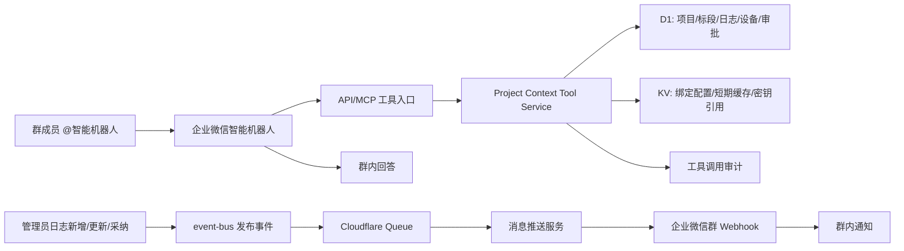
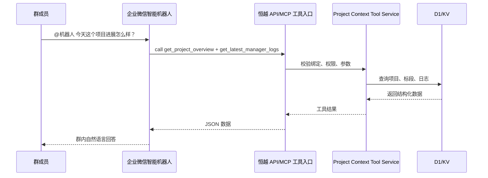
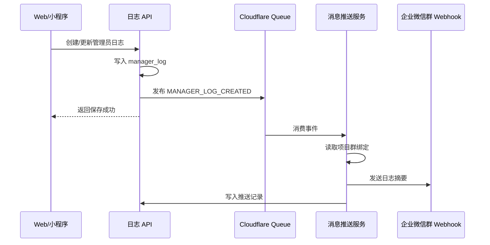

# 企业微信智能机器人工具优先架构设计

## 1. 设计结论

采用“工具优先架构”：

- 企业微信智能机器人负责群内自然语言理解、对话组织和回答生成。
- 恒越后台只提供企业微信智能机器人可调用的受控数据工具，工具形态同时兼容 HTTP API 与 MCP。
- 项目日志、风险、审批等主动通知不走智能机器人问答链路，统一走企业微信群聊“消息推送 Webhook”。
- 未来写入能力也通过工具暴露，但必须经过权限、幂等、审计和人工确认边界。

该设计替代“我们自行接收群消息、调用 AI Slot 生成回答、再推回群聊”的旧设想。旧设想可作为极端兼容 fallback，不作为主线。

## 2. 外部能力理解

### 2.1 企业微信智能机器人

基于当前企业微信智能机器人说明与实际接入资料，智能机器人的核心工作模式应理解为：

1. 群成员在企业微信群内 @ 智能机器人并提出问题。
2. 企业微信智能机器人处理对话上下文。
3. 机器人按配置调用企业开发者提供的 API 或 MCP 工具获取业务数据。
4. 机器人基于工具返回的数据自行生成群内回答。

因此，我们的重点不是再造一个聊天机器人，而是提供：

- 稳定的数据查询工具；
- 清晰的工具描述与参数 schema；
- 安全的授权边界；
- 可审计的工具调用记录；
- 对智能机器人友好的结构化返回。

### 2.2 企业微信群消息推送

群内主动通知使用企业微信内置“消息推送 Webhook”能力：

1. 项目日志新增、更新或外部日志采纳后，业务 API 发布领域事件。
2. Queue 消费事件，组装通知文案。
3. 后端读取项目绑定的群消息推送 Webhook secret。
4. 调用企业微信群 Webhook 发送消息。

这条链路不需要智能机器人参与问答推理，只承担“系统事件通知”。

用户补充的企业微信开发文档 `https://developer.work.weixin.qq.com/document/path/91770` 对应的是“企业微信群机器人 / 群机器人 Webhook”能力。它适合作为本方案的日志主动推送通道，而不是智能机器人问答工具调用通道。

设计边界：

- 91770 群机器人 Webhook 用于系统主动向群里发送通知。
- 智能机器人 API/MCP 用于群成员提问时调用我们的业务工具获取数据。
- 两者可以绑定同一个项目群，但后端实现必须拆成两个适配器，不能把 Webhook 推送接口当成问答入口。
- 第一期通知消息只使用 `text` 或 `markdown`，避免图文、文件、卡片等格式增加联调复杂度；后续消息类型以 91770 当前官方文档为准扩展。

### 2.3 需要在租户内验证的点

- 智能机器人在当前企业微信版本下支持的工具接入形态：HTTP API、MCP，或两者均支持。
- 企业微信智能机器人调用 API/MCP 时的认证方式、回调验签字段、超时限制和返回格式。
- 91770 群机器人 Webhook 在当前企业租户里是否支持目标外部群。若不覆盖外部群，外部群继续保留“客户群群发、群主确认发送”的 fallback。
- 智能机器人是否能区分不同群聊身份，并把 group/chat 标识传给工具调用方。

## 3. 与现有系统的对齐

现有系统已有明确基础设施：

- API 入口：`packages/api/src/index.ts`，Hono + `/api/v1` 路由。
- 事件总线：`packages/api/src/services/event-bus.ts`，基于 Cloudflare Queue，事件写入 `event_log`。
- Queue 消费：`packages/api/src/queue-handler.ts`。
- AI 任务：`AI Slot + task_queue + ai_audit_log`，计算节点 pull 模式执行。
- 企业微信桥接：`bridge/README.md`，用于固定公网 IP、可信 IP、企业微信 API 代理和回调转发。
- 日志业务：`packages/api/src/routes/log.ts`，管理员日志创建、更新、照片管理。

工具优先架构必须遵守这些边界：

- 不绕过现有认证、审计、事件总线和桥接服务。
- 不在工具服务里直接硬编码 OpenAI、Claude 或其他 AI Provider。
- 只读工具不进入 `task_queue`，因为它们不是 AI 任务。
- 如果某个工具需要由我们系统生成 AI 摘要，则必须创建现有 AI Slot 任务，异步处理并写入 `ai_audit_log`。
- 主动通知必须通过 Queue 削峰，不能在日志提交请求里同步调用外部 Webhook。

## 4. 总体架构



## 5. 核心模块设计

### 5.1 工具核心服务

新增服务层，建议命名：

- `packages/api/src/services/wecom-project-tools.ts`
- `packages/api/src/types/wecom-tools.ts`

职责：

- 定义工具名称、入参、出参和权限级别。
- 按 `project_id`、`section_id`、时间范围、日志类型读取业务数据。
- 对返回内容做脱敏与裁剪，避免把财务、合同、报销等无关敏感数据泄露到群。
- 统一返回结构化 JSON，而不是自由文本。

第一阶段只读工具：

| 工具名                     | 作用                                 | 典型参数                                      |
| -------------------------- | ------------------------------------ | --------------------------------------------- |
| `get_project_overview`     | 查询项目概况、状态、负责人、地点     | `project_id`                                  |
| `list_project_sections`    | 查询项目标段/工作段                  | `project_id`                                  |
| `get_section_progress`     | 查询标段里程、累计进尺、最近施工状态 | `project_id`, `section_id`                    |
| `get_latest_manager_logs`  | 查询最近管理员日志                   | `project_id`, `limit`, `date_from`, `date_to` |
| `get_latest_operator_logs` | 查询最近操作员施工日志               | `project_id`, `section_id`, `limit`           |
| `get_project_risk_summary` | 汇总风险、停工、异常备注             | `project_id`, `days`                          |
| `get_equipment_summary`    | 查询项目拟派/在场设备摘要            | `project_id`                                  |
| `get_public_log_link`      | 获取项目日志公示链接                 | `project_id`                                  |

第二阶段写入工具：

| 工具名                      | 作用                       | 写入边界                      |
| --------------------------- | -------------------------- | ----------------------------- |
| `create_manager_log_draft`  | 创建管理员日志草稿         | 只写草稿，不自动发布          |
| `create_project_issue`      | 创建项目问题/风险记录      | 需要 caller_userid 与项目权限 |
| `update_section_mileage`    | 更新标段基础里程或当前进度 | 高风险，默认需要人工确认      |
| `request_equipment_support` | 发起设备支援请求           | 进入审批或任务流              |

写入工具不进入第一阶段。

### 5.2 HTTP API 适配器

新增路由建议：

- `packages/api/src/routes/wecom-tools.ts`

接口形态：

- `POST /api/v1/wecom/tools/call`
- `GET /api/v1/wecom/tools/manifest`
- `GET /api/v1/wecom/tools/health`

`/call` 请求示例：

```json
{
  "tool": "get_project_overview",
  "input": {
    "project_id": 12
  },
  "context": {
    "bot_id": "bot_xxx",
    "group_chat_id": "wrxxx",
    "caller_userid": "zhangsan"
  }
}
```

返回示例：

```json
{
  "success": true,
  "data": {
    "project_id": 12,
    "project_name": "某项目",
    "status": "active",
    "manager_userid": "lisi",
    "sections_count": 3,
    "updated_at": "2026-05-18T09:30:00.000Z"
  },
  "meta": {
    "tool": "get_project_overview",
    "data_scope": "project",
    "generated_at": "2026-05-18T09:31:00.000Z"
  }
}
```

HTTP 适配器只负责协议、认证、参数解析和响应封装；业务数据读取委托给工具核心服务。

### 5.3 MCP 适配器

当企业微信智能机器人确认可直接接 MCP 时，提供远程 MCP 入口：

- `POST/GET /mcp/wecom`

实现原则：

- MCP 工具与 HTTP 工具共用同一套工具核心服务。
- MCP tool 名称、参数 schema 和说明从 `wecom-tools` 注册表生成。
- MCP 层不直接访问数据库，避免出现两套业务逻辑。
- 鉴权优先使用企业微信智能机器人可配置的 token 或 OAuth；若企业微信只支持固定 secret，则通过桥接/网关转换为内部鉴权上下文。

Cloudflare Workers 支持远程 MCP 服务，但具体 SDK 和传输形态需在进入开发前按当期 Cloudflare 官方文档确认。

### 5.4 项目群绑定

新增绑定表，建议字段：

```sql
CREATE TABLE project_wecom_bot_binding (
  id INTEGER PRIMARY KEY AUTOINCREMENT,
  project_id INTEGER NOT NULL,
  binding_name TEXT NOT NULL,
  group_chat_id TEXT,
  bot_id TEXT,
  allowed_tools_json TEXT NOT NULL,
  data_scope TEXT NOT NULL DEFAULT 'project',
  push_webhook_secret_ref TEXT,
  push_enabled INTEGER NOT NULL DEFAULT 1,
  qa_enabled INTEGER NOT NULL DEFAULT 1,
  status TEXT NOT NULL DEFAULT 'active',
  created_by TEXT,
  created_at TEXT NOT NULL,
  updated_at TEXT NOT NULL
);
```

说明：

- `allowed_tools_json` 控制该群可调用的工具集合。
- `push_webhook_secret_ref` 只存密钥引用，真实 Webhook 存 KV 或 Secrets。
- 一个项目可以绑定多个群。
- 一个群原则上只绑定一个项目；如果要绑定多个项目，必须要求用户在提问中显式指定项目。

### 5.5 工具调用审计

新增审计表，建议字段：

```sql
CREATE TABLE wecom_tool_call_audit (
  id INTEGER PRIMARY KEY AUTOINCREMENT,
  binding_id INTEGER,
  project_id INTEGER,
  tool_name TEXT NOT NULL,
  caller_userid TEXT,
  group_chat_id TEXT,
  request_json TEXT NOT NULL,
  response_summary TEXT,
  status TEXT NOT NULL,
  error_message TEXT,
  latency_ms INTEGER NOT NULL DEFAULT 0,
  created_at TEXT NOT NULL
);
```

审计目标：

- 能追踪哪个群、哪个机器人、哪个用户调用了哪个工具。
- 能排查权限拒绝、参数错误、数据为空、超时等问题。
- 不记录过长全文，`response_summary` 只保留摘要或计数，避免审计表膨胀。

### 5.6 消息推送服务

新增服务层，建议命名：

- `packages/api/src/services/wecom-message-push.ts`

触发事件建议：

- `MANAGER_LOG_CREATED`
- `MANAGER_LOG_UPDATED`
- `EXTERNAL_LOG_ADOPTED`

事件发布点：

- 管理员日志创建成功后发布 `MANAGER_LOG_CREATED`。
- 管理员日志更新成功后发布 `MANAGER_LOG_UPDATED`。
- 外部日志采纳为管理员日志后发布 `EXTERNAL_LOG_ADOPTED`。

Queue 消费后：

1. 读取项目有效绑定。
2. 过滤 `push_enabled = 1`。
3. 从 KV/Secrets 读取 `push_webhook_secret_ref` 对应 Webhook。
4. 组装 markdown 或 text 消息。
5. 调用企业微信群 Webhook。
6. 写入推送事件记录。

## 6. 安全与权限

### 6.1 鉴权

工具入口至少需要一层服务端鉴权：

- 固定 token：适合第一阶段快速接入企业微信智能机器人。
- HMAC 签名：适合企业微信能透传 timestamp/nonce/body 的场景。
- OAuth：适合 MCP 客户端支持标准 OAuth 的场景。

第一阶段建议：

- HTTP API 使用 `WECOM_BOT_TOOL_TOKEN`。
- MCP 若上线，优先选择 Cloudflare Workers OAuth Provider；若企业微信不支持 OAuth，则使用企业微信侧支持的固定 secret 转内部 token。

### 6.2 数据权限

工具返回数据必须同时满足：

- 群绑定允许访问该项目。
- 工具名在 `allowed_tools_json` 内。
- 如企业微信传入 `caller_userid`，则可进一步按项目角色校验。
- 默认禁止返回合同金额、付款、报销、收款明细等财务数据。

### 6.3 写入权限

第一阶段不开放写入工具。

未来开放写入时，必须满足：

- 工具 schema 明确写入字段。
- 每次调用带 idempotency key。
- 高风险动作只生成草稿或审批，不直接改最终状态。
- 写入结果进入 `event_log` 和业务审计表。

## 7. 前端配置设计

项目工作区新增“企业微信群与智能机器人”配置区，不新增全局孤立功能页。

页面位置：

- `packages/web/src/views/project/workspace/project-panel.vue`

组件建议：

- `packages/web/src/views/project/workspace/components/wecom-tool-binding-panel.vue`

功能：

- 展示当前项目绑定的群。
- 添加/编辑群名、群 ID、bot ID。
- 配置是否启用问答。
- 配置允许调用的工具。
- 配置是否启用日志消息推送。
- 填入或选择 Webhook secret 引用。
- 发送测试消息。
- 查看最近工具调用和消息推送结果。

加载与结果反馈：

- 列表加载使用 skeleton 或 `el-table` loading。
- 保存、删除、测试发送必须有按钮 loading。
- 成功后刷新绑定列表和最近事件。
- 失败时显示明确错误原因。

## 8. 运行链路

### 8.1 群内问答



### 8.2 日志主动通知



## 9. 分阶段落地

### Phase A：设计与租户验证

- 在企业微信后台确认智能机器人 API/MCP 配置项。
- 验证消息推送 Webhook 对内部群和外部群的支持边界。
- 确认企业微信调用工具时是否提供 group/chat/user 上下文。
- 固化工具 schema 和返回结构。

### Phase B：只读工具与 API 入口

- 新增工具核心服务。
- 新增 HTTP `/api/v1/wecom/tools/*` 路由。
- 新增绑定表和审计表。
- 项目工作区新增绑定 UI。
- 完成只读工具测试。

### Phase C：消息推送

- 新增消息推送绑定字段与事件表。
- 日志创建/更新/采纳发布事件。
- Queue 消费后调用群 Webhook。
- 项目工作区支持测试发送和推送结果查看。

### Phase D：MCP 入口

- 按企业微信最终支持形态接入远程 MCP。
- MCP 工具复用 Phase B 的工具核心服务。
- 用 MCP Inspector 或企业微信联调验证工具调用。

### Phase E：写入工具

- 只开放低风险写入草稿。
- 增加人工确认、审批或任务流。
- 补充写入审计与回滚策略。

## 10. 测试策略

后端单元测试：

- 工具参数校验。
- 群绑定权限校验。
- 空数据返回。
- 敏感字段不返回。
- 审计记录写入。
- Webhook 推送成功、失败、超时。

后端集成测试：

- 日志创建后发布事件。
- Queue 消费后读取绑定并推送。
- 工具入口按 token 拒绝未授权请求。

前端测试：

- 绑定列表加载态。
- 保存/删除/测试发送 loading。
- 错误提示。
- 最近调用结果刷新。

人工联调：

- 企业微信智能机器人调用 `get_project_overview`。
- 群里提问“今天项目有什么风险”时调用日志和风险工具。
- 新增管理员日志后群内收到消息推送。

## 11. 风险与约束

| 风险                                                  | 影响               | 处理                                         |
| ----------------------------------------------------- | ------------------ | -------------------------------------------- |
| 官方智能机器人 API/MCP 协议细节和第三方文档不完全一致 | 接口返工           | 先做工具核心服务，协议适配层可替换           |
| 外部群不支持消息推送 Webhook                          | 外部群无法自动推送 | 保留客户群群发 fallback                      |
| 群绑定项目不清晰                                      | 机器人答错项目     | 默认一个群绑定一个项目，多项目必须显式选择   |
| 工具返回敏感数据                                      | 信息泄露           | 第一阶段只开放项目、标段、日志、设备摘要     |
| 同步查询超时                                          | 机器人回答失败     | 工具限制 limit，复杂摘要走缓存或异步 AI Slot |
| 写入工具误操作                                        | 业务状态被错误修改 | 第一阶段不开放写入；二期只写草稿或审批       |

## 12. 参考资料

- 企业微信智能机器人帮助文档：`https://open.work.weixin.qq.com/help2/pc/21663`
- 企业微信群机器人 Webhook 文档：`https://developer.work.weixin.qq.com/document/path/91770`
- AstrBot 企业微信智能机器人接入说明：`https://docs.astrbot.app/platform/wecom_ai_bot.html`
- PicoClaw 企业微信智能机器人说明：`https://docs.picoclaw.io/zh-Hans/docs/channels/wecom-aibot/`
- Cloudflare Remote MCP Server 文档：`https://developers.cloudflare.com/agents/guides/remote-mcp-server/`
- Cloudflare MCP Agent API 文档：`https://developers.cloudflare.com/agents/model-context-protocol/mcp-agent-api/`

说明：企业微信官方页面可能需要在企业微信后台或浏览器登录环境中查看，开发前必须以当前租户后台可见配置为最终准绳。
